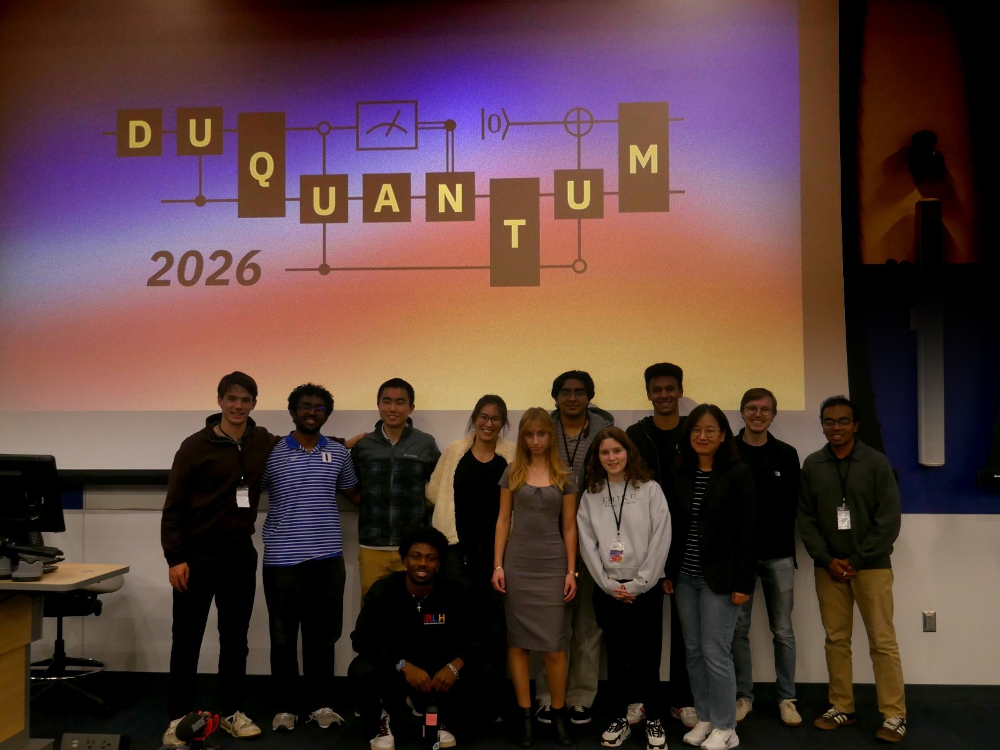
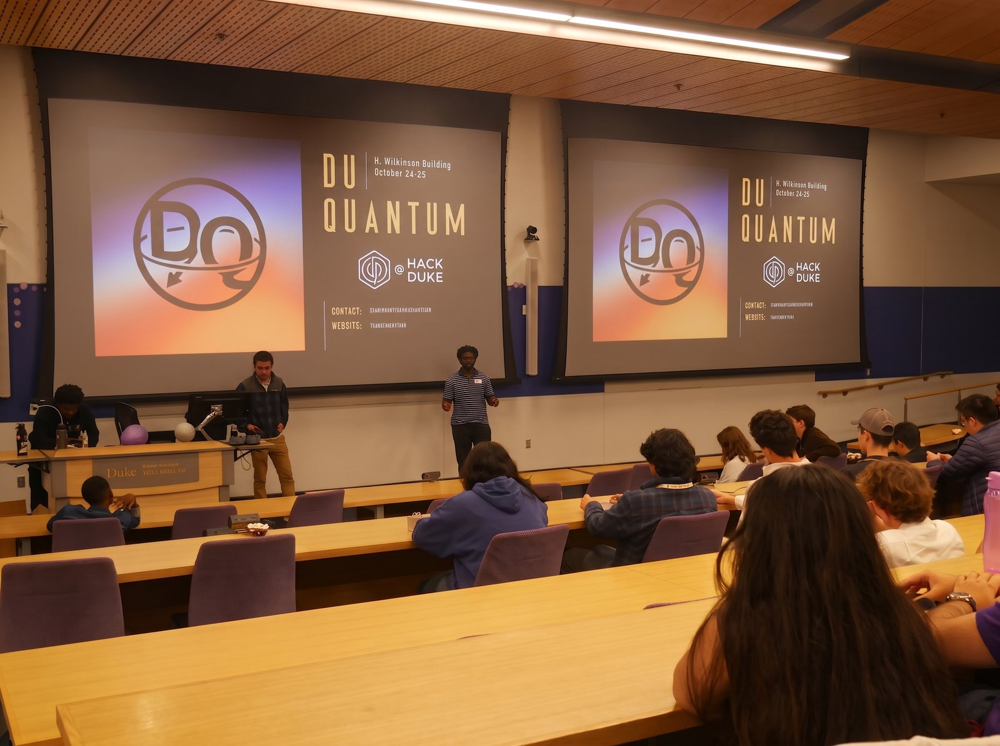
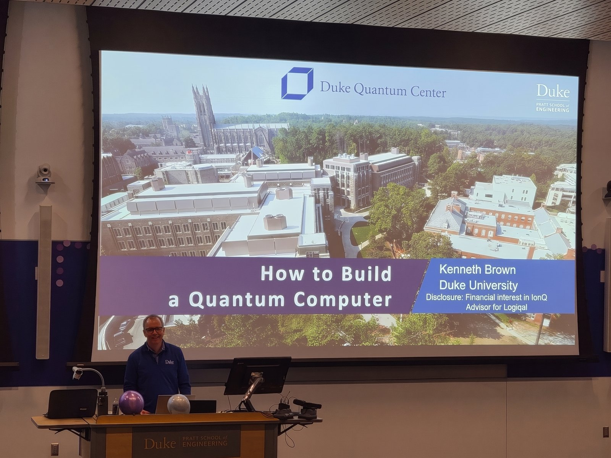
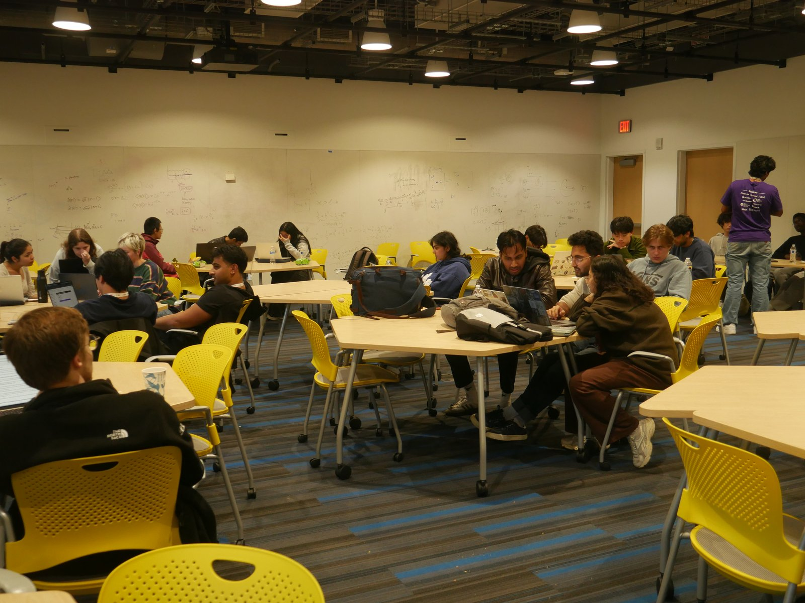

## DuQuantum 2026

*President, Duke Quantum Information Society · [duquantum.org](https://duquantum.org/)*

{fig-alt="The DuQuantum organizing team and sponsor representatives posing in front of a projected DuQuantum 2026 logo drawn as a quantum circuit"}

**DuQuantum 2026** was the first quantum computing hackathon ever held at Duke University. For 24 hours,
more than **130 students** in over **40 teams** worked on quantum computing challenges, from
complete beginners writing their first quantum circuits to advanced students tackling
problems at the frontier of the field. I led the organizing team that put it together.

- **Two tracks.** Participants chose an **Intro Track** or a **Standard Track** depending on
  their background, so newcomers and experienced students could both find the right
  challenge.
- **Six industry and academic challenges** from **IQM**, **Alice & Bob**, **BlueQubit**,
  **Google**, the **Duke Quantum Center (DQC)**, and **Pasqal**. DuQuantum was the first
  quantum hackathon Pasqal has sponsored.
- **Over $30,000 in sponsorships**, with **more than $4,000 in prizes** awarded.
- **The first quantum computing hackathon to be a Major League Hacking (MLH) member event.**
  We were also supported by IBM Quantum through Qiskit Fall Fest.

::: {layout-ncol="3"}
{fig-alt="Organizers speaking at the DuQuantum opening ceremony in a lecture hall, with the DuQuantum logo on two screens"}

{fig-alt="Prof. Kenneth Brown presenting a talk titled How to Build a Quantum Computer, with a Duke Quantum Center slide behind him"}

{fig-alt="Students working at laptops around tables during the hackathon"}
:::

DuQuantum was made possible by our sponsors (Alice & Bob, Pasqal, BlueQubit, Google, IQM
Quantum Computers, Classiq, Quandela, neQxt, the Duke Physics Department, and the Duke Rhodes
Information Initiative), by faculty and staff of the Duke Quantum Center, and by an
organizing team that worked on it for months. Most of all, it was made by the participants.
We hope to see you all, and more, next year!
