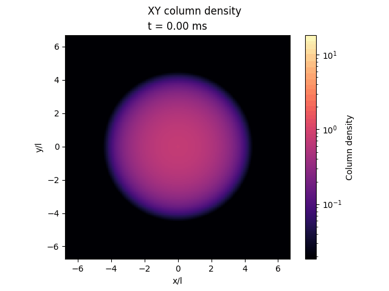
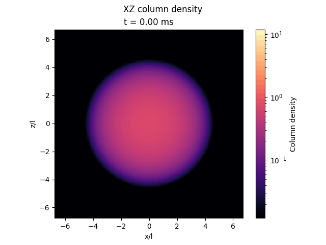
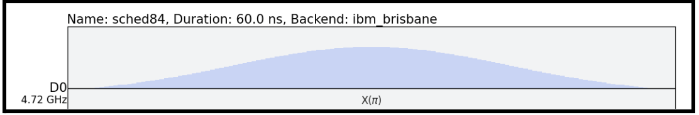
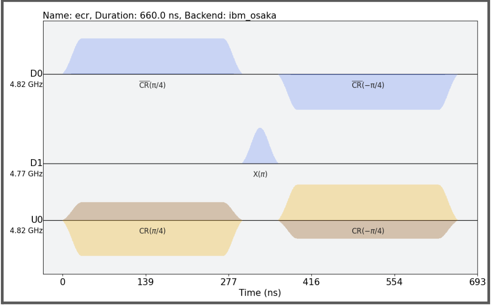
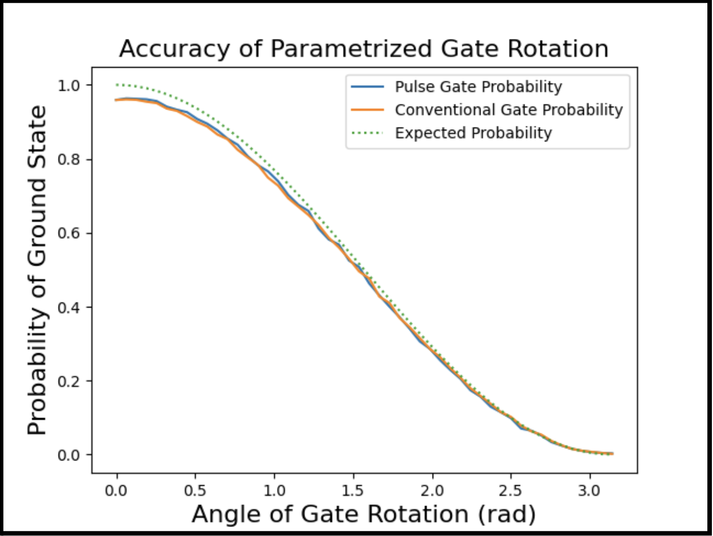
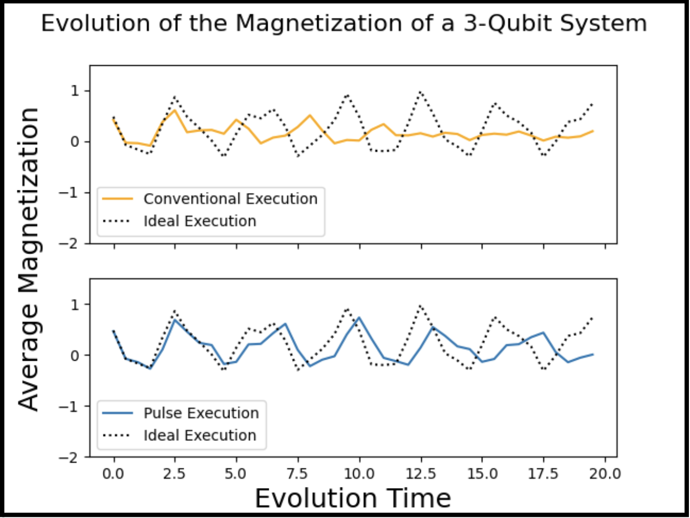
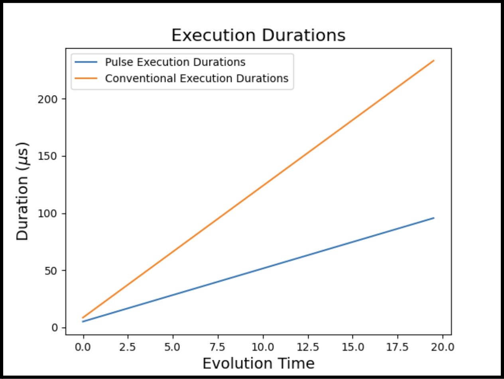
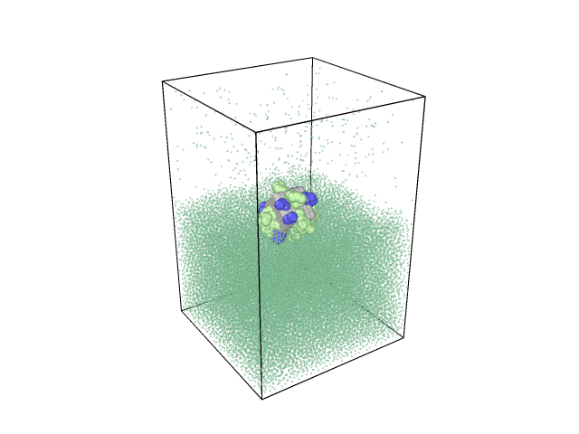

## Interests

I'm interested in quantum information science, especially where it meets condensed matter
and atomic physics: quantum materials, quantum algorithms, and quantum information theory.
In practice that has meant numerical simulation of quantum many-body systems, entanglement
in quantum fields, and running algorithms on real quantum hardware. Working on Bose-Einstein
condensates has recently pulled me toward AMO physics, and I'm now starting a project on
quantum information processing with indium atoms.

## Simulating an indium Bose-Einstein condensate

*Nicholson Lab (Ultracold Atoms), Duke University · Advisor: Prof. Travis Nicholson ·
October 2025 – Present*

::: {.research-row}
::: {.research-text}
**The question.** The Nicholson lab is working toward a Bose-Einstein condensate (BEC) of
indium atoms. Indium's properties suggest its atoms may scatter off each other
*anisotropically*, meaning the interaction depends on direction, which could produce new
physics in the condensate. The condensate's dynamics are governed by an extended
**Gross-Pitaevskii equation (GPE)**, a nonlinear version of the Schrödinger equation for
BECs, with anisotropic interaction terms relevant to indium.

**What I built.** A 3D simulation of this extended, anisotropic GPE, solved with the
**Fourier split-step method**. It can:

- find the condensate's ground state with **imaginary-time evolution**, then evolve it in
  **real time**, switching between the two with a single option;
- run in a selectable **trapping potential** (harmonic or others), with new potentials easy
  to add;
- **quench** the system by changing the potential or interaction parameters partway through
  a run and following the response;
- save intermediate frames and render movies of the density, like the ones shown here.

The code is object-oriented and GPU-accelerated in PyTorch, which made it **13.5× faster**
than the original version. I checked it against problems with known answers (the 1D, 2D and
3D harmonic oscillators, then the standard GPE) and set the grid so that several points
cover the condensate's **healing length**, the shortest length scale in the system.
:::

::: {.research-media}
{fig-alt="Animated column density of the condensate in the xy plane, breaking up into a lattice of density peaks" loading="lazy"}

{fig-alt="Animated column density of the condensate in the xz plane, showing stripe-like density modulation" loading="lazy"}

[Example real-time run: column density in the *xy* (top) and *xz* (bottom) planes.]{.research-caption}
:::
:::

Building it meant learning both the numerical methods (finite differences, operator
splitting, the FFT and Nyquist sampling) and the physics behind the equation (the
mean-field and Thomas-Fermi approximations, Bogoliubov theory, trapping, and droplet
phases). In the lab, I also build, calibrate, and test custom electronics (e.g., a digital
loop filter) for the atomic physics experiments.

## Detecting entanglement in scalar fields with majorization

*Duke University · Advisor: Prof. Natalie Klco · August 2025 – Present*

**The question.** How much entanglement exists between two separate, non-overlapping
regions of a quantum scalar field, and how can we detect it? I'm studying whether
**majorization** (a mathematical way of ordering probability distributions by how "spread
out" they are) gives useful criteria for detecting that entanglement, and how the
entanglement behaves in the **continuum limit**.

**What I did.** I ran parallelized Mathematica computations to apply majorization
techniques to scalar-field entanglement, and numerically computed how entanglement between
disjoint regions scales as the field approaches the continuum. I wrote mathematical proofs
to confirm the numerical results rigorously, and compared our methods against standard
benchmarks to make sure the results are accurate and reproducible.

**Where it went.** I presented this work as *Divergence of Assisted Entanglement in the
Continuum Limit of Scalar Fields* at the Duke Undergraduate Research Symposium (April 2026).
A manuscript is in progress.

::: {.research-refs}
**References**

1. B. Gao and N. Klco, Detecting spacelike vacuum entanglement at all distances and
   promoting negativity to a necessary and sufficient entanglement measure in many-body
   regimes, *Phys. Rev. A* **112**, 012430 (2025).
   [doi:10.1103/m9w1-ppqz](https://doi.org/10.1103/m9w1-ppqz) · [arXiv:2410.04162](https://arxiv.org/abs/2410.04162)
:::

## Quantum error detection with Pauli checks

*Argonne National Laboratory (DOE SULI) · Advisors: Dr. Zain Saleem and Dr. Ji Liu ·
May – December 2025*

**The question.** Errors on today's quantum computers can be caught by "sandwiching" part of
a circuit between Pauli checks: extra operations that flag runs where an error occurred, so
those runs can be thrown out. Real hardware noise is often *biased*, with some kinds of
errors far more likely than others. How well do these checks hold up under biased noise, and
how should a compiler use them?

**What I did.** I benchmarked a Pauli-check error-detection protocol under biased noise
models, to inform how **QuantEM**, a quantum error management compiler, applies error
detection. The work involved an in-depth literature review, simulation experiments, and data
analysis in Pandas.

**Where it went.** The work is part of the QuantEM paper
([arXiv:2509.15505](https://arxiv.org/abs/2509.15505)), and I presented it as *Automatic
Quantum Error Detection with Pauli Checks* at Argonne (August 2025). It also motivated
an investigation into using deep learning models to characterize hardware noise.

::: {.research-refs}
**References**

1. A. Gonzales, R. Shaydulin, Z. H. Saleem, and M. Suchara, "Quantum error mitigation by
   Pauli check sandwiching," *Sci. Rep.* **13**, 2122 (2023).
2. D. M. Debroy and K. R. Brown, "Extended flag gadgets for low-overhead circuit
   verification," *Phys. Rev. A* **102**, 052409 (2020).
   [doi:10.1103/PhysRevA.102.052409](https://doi.org/10.1103/PhysRevA.102.052409)
3. E. van den Berg, S. Bravyi, J. M. Gambetta, P. Jurcevic, D. Maslov, and K. Temme,
   "Single-shot error mitigation by coherent Pauli checks," *Phys. Rev. Research* **5**,
   033193 (2023).
:::

## Faster quantum gates through pulse-level control

*North Carolina State University · Advisor: Prof. Lex Kemper · July – August 2023*

**The question.** On superconducting quantum computers, each gate is ultimately a microwave
pulse, and qubits decohere over time, so longer circuits accumulate more error. Can we
shorten circuits by working directly at the pulse level instead of assembling every
operation from a fixed set of native gates?

**What I did.** Using Qiskit Pulse on IBM backends, I built parametrized gates by scaling
the calibrated microwave pulses (single-qubit drives and the cross-resonance pulses inside
the two-qubit ECR gate) instead of decomposing rotations into standard gate sequences. I
checked that the pulse-scaled rotations matched the conventional gates' accuracy, then used
them to simulate the time evolution of a 3-qubit spin system.

**Where it went.** Operations ran about **60% faster**. Shorter execution let us simulate
the system to longer times: the pulse-level circuits tracked the ideal magnetization
dynamics noticeably longer than the conventionally compiled ones.

::: {layout="[[1,1]]"}
{fig-alt="Pulse schedule of a 60 ns Gaussian-like X(pi) drive pulse on ibm_brisbane"}

{fig-alt="Pulse schedule of a 660 ns echoed cross-resonance gate on ibm_osaka across drive and control channels"}
:::

::: {layout-ncol="3"}
{fig-alt="Plot of ground-state probability versus rotation angle; pulse and conventional gates overlap and track the expected cosine-squared curve"}

{fig-alt="Two panels of average magnetization versus evolution time; the pulse execution follows the ideal curve longer than the conventional execution"}

{fig-alt="Plot of execution duration versus evolution time; pulse durations grow much more slowly than conventional durations"}
:::

::: {.research-refs}
**References**

1. P. Gokhale, A. Javadi-Abhari, N. Earnest, Y. Shi, and F. T. Chong, "Optimized quantum
   compilation for near-term algorithms with OpenPulse," arXiv:2004.11205v2 [quant-ph]
   (2020). [arXiv:2004.11205](https://arxiv.org/abs/2004.11205)
2. J. P. T. Stenger, N. T. Bronn, D. J. Egger, and D. Pekker, "Simulating the dynamics of
   braiding of Majorana zero modes using an IBM quantum computer," *Phys. Rev. Research*
   **3**, 033171 (2021).
:::

## Interfacial free energy of soft matter with molecular dynamics

*Duke University · Advisor: Prof. Gaurav Arya · June 2026 – Present*

::: {.research-row}
::: {.research-text}
**The question.** When a particle sits at an interface, its free energy depends on how it
is oriented. Mapping that orientational free energy landscape tells us which orientations
a soft matter system prefers, and how strongly.

**What I did.** I implemented a data-driven model to map the orientational interfacial
free energy landscape. To build it, I run molecular dynamics simulations in LAMMPS across
many physical configurations, parallelized on an HPC Slurm cluster, and compute
**potentials of mean force** with **umbrella sampling** to characterize the system's
thermodynamics.
:::

::: {.research-media}
{fig-alt="Animated molecular dynamics simulation of a particle held at a fixed orientation in a box of solvent" loading="lazy"}

[Molecular dynamics simulation with the particle's orientation constrained.]{.research-caption}
:::
:::

## Publications & Talks

- **QuantEM: The quantum error management compiler.**
  [arXiv:2509.15505](https://arxiv.org/abs/2509.15505) [quant-ph], September 2025
- *Divergence of Assisted Entanglement in the Continuum Limit of Scalar Fields*, Duke
  University Undergraduate Research Symposium, April 2026
- *Automatic Quantum Error Detection with Pauli Checks*, Argonne National Laboratory
  (SULI), August 2025
